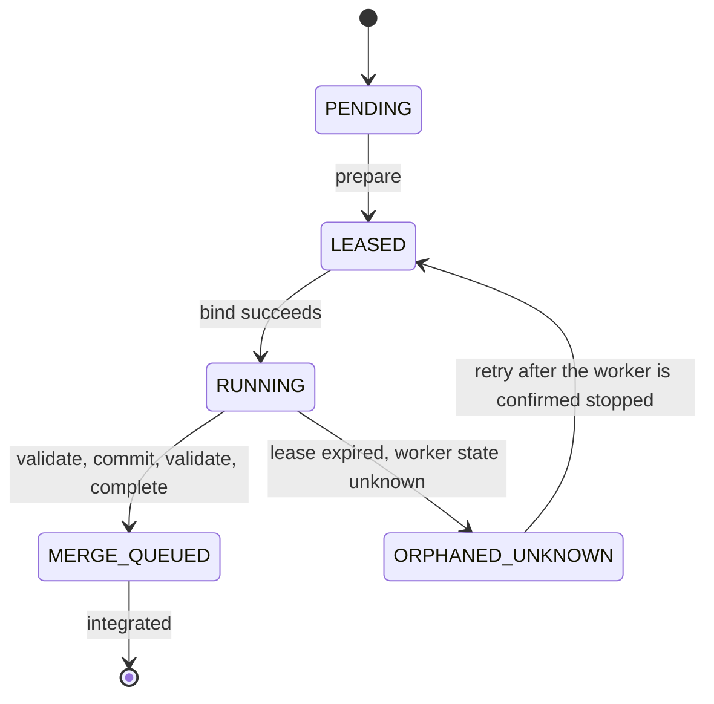

# ORCH

ORCH is a local coordination runtime for work started inside an existing Codex or Claude Code conversation. The current session stays in charge; MCP manages configuration, task state, Git worktrees, checks, reviews and recovery.

**Development implementation, not a completed v1 release.** Installation readies the MCP; the current conversation connects its native Agent tool automatically before running workers. Each role resolves its own model/effort from authenticated host capabilities; unsupported pins remain blocked and actual observations stay separate. Deterministic tests alone do not prove native host execution. See [compatibility](docs/compatibility.md) and [acceptance evidence](docs/acceptance.md). The [completion audit](docs/prd-completion.md) tracks the current findings and pending evidence.

## Install once

Requires **Node.js 24+** (with npm), Git, and Codex CLI or Claude Code. From this checkout, run one command:

```sh
./scripts/install.sh
```

The installer handles missing npm dependencies, local packaging, checksums and installation for all detected hosts. It preserves unrelated settings and refuses user-owned skill/MCP conflicts. Run the same command again to update; unchanged sources reuse the installed version. No manual bundle or checksum is needed.

For a fresh checkout:

```sh
git clone https://github.com/garhidiba/agent-orchestrator.git
cd agent-orchestrator
./scripts/install.sh
```

On Windows PowerShell, run `./scripts/install.ps1` instead. Installation registers the `orch` MCP server and copies `agent-orch` / `agent-orch-configure` into each host's skills directory. Restart/reload the host afterward.

Both detected hosts are installed automatically. After restarting, use `$agent-orch init` in Codex or **`/agent-orch init` in Claude Code**. The default installer installs standalone skills; it does not activate the optional Claude plugin, so `/agent-orch:init` is not a default-install command. If Claude reports `Unknown command: /agent-orch:init`, use `/agent-orch init` instead. See [optional plugin loading](docs/installation.md#diagnostics-and-claude-plugin) only if you specifically need namespaced plugin commands.

The default installation is user-wide. Keep this ORCH checkout separate from the client projects you manage; installation is done once, not in every client repository.

Optional: `./scripts/install.sh --target codex` selects just Codex (`claude` selects Claude Code); `--dry-run` previews host changes. Project-only installation uses `--scope project --project /absolute/path/to/git-root`. Dependency setup can still write local `node_modules` during a preview. See [installation](docs/installation.md) for paths, advanced verified-bundle options and removal.

## Use in a conversation

1. Restart/reload the host after installation, then open the Git project you want ORCH to manage.
2. Check that the `orch` MCP server and both skills are discovered. In Codex, `codex mcp get orch` checks registration; `/mcp` inside the TUI shows active servers ([official MCP guide](https://learn.chatgpt.com/docs/extend/mcp?surface=cli)). Registration alone does not prove a successful connection.
3. Initialize the actual client Git project in that conversation:

   ```text
   $agent-orch init
   ```

   In Claude Code use `/agent-orch init` after the default installation. The skill verifies the MCP origin against the physical client Git root before writing. Initialization creates or completes only `.orch/config.yaml`: the client needs no `package.json`, `node_modules`, ORCH checkout or copied ORCH code. Global settings remain unchanged.

The file visibly includes all eight roles for both hosts, model/effort policies, and execution, Git, review, quality and other defaults. Missing fields are seeded from global settings and shipped defaults; existing values and comments are preserved. Initialization configures the project without starting a run or an AI worker. Concrete role-model setup uses supported current-host metadata through `agent-orch-configure`; unresolved `auto` values remain explicit when that metadata is unavailable. A full file alone does not mean workers are ready.

For a read-only preview use `$agent-orch init 설정 파일 변경안을 보여줘. 아직 쓰지 마.` An ordinary first invocation also creates a missing full config, while preserving existing files. Explicit no-write requests and direct configuration explanations remain read-only. Commit the generated project file according to your project policy before a write run that requires a clean checkout; agent-orch does not silently commit it.

The entry names are now `$agent-orch` / `$agent-orch-configure` (Codex) and `/agent-orch` / `/agent-orch-configure` (Claude). Internal `orch_*` MCP tools and `.orch` data paths retain their names for compatibility. Updating moves only installer-owned old skills; edited/user-owned files block migration rather than being overwritten.

| Goal | Codex prompt | Claude Code prompt |
|---|---|---|
| Initialize this client project | `$agent-orch init` | `/agent-orch init` |
| Inspect environment and capabilities | `$agent-orch 현재 환경과 실행 가능 상태를 확인해줘` | `/agent-orch 현재 환경과 실행 가능 상태를 확인해줘` |
| Explain current settings without changing them | `$agent-orch-configure 현재 모델과 설정을 설명해줘. 변경하지 마` | `/agent-orch-configure 현재 모델과 설정을 설명해줘. 변경하지 마` |
| Preview a project profile change | `$agent-orch-configure 이 프로젝트를 quality 프로필로 바꾸는 변경안을 보여줘` | `/agent-orch-configure 이 프로젝트를 quality 프로필로 바꾸는 변경안을 보여줘` |
| Read an existing run | `$agent-orch run-<ID> 상태와 보고서를 보여줘` | `/agent-orch run-<ID> 상태와 보고서를 보여줘` |

### Copyable prompts

Use these in the host conversation, not in a terminal. In Claude Code, replace `$agent-orch` / `$agent-orch-configure` with `/agent-orch` / `/agent-orch-configure`.

Initialize the client project, then inspect current settings:

```text
$agent-orch init
$agent-orch 현재 프로젝트의 환경, MCP 연결과 실행 가능 상태를 확인해줘. 파일은 변경하지 마.
$agent-orch-configure 현재 프로필과 역할별 모델·추론 설정을 설명해줘. 설정은 바꾸지 마.
```

To change configuration, request a preview first and approve the concrete proposal in the next message:

```text
$agent-orch-configure 이 프로젝트를 quality 프로필로 바꾸는 변경안을 보여줘. 기존에 고정한 모델은 유지하고 아직 적용하지 마.
```

```text
$agent-orch-configure 방금 확인한 변경안을 이 프로젝트에만 적용해줘. 전역 설정과 기존 모델 고정값은 유지해줘.
```

For an existing run, substitute its actual ID:

```text
$agent-orch run-<ID>의 진행 상태, 차단 이유와 보고서를 보여줘.
```

A work request should include a concrete result and verification command. For example:

```text
$agent-orch 이 저장소의 설정 조회 CLI에 --help 예제를 추가해줘. 기존 출력은 유지하고 npm run check로 검증해줘. 먼저 실행 가능 상태를 확인하고 지원되지 않으면 중단해.
```

On an execution request, `$agent-orch` first connects this conversation’s native Agent tool with a read-only probe, then prepares worktrees and binds workers before edits. You do not need to start a separate app-server daemon or run a manual connection command.

**Readiness:** `installation=READY` means MCP is ready; `NEEDS_HOST_HANDSHAKE` asks the skill to connect the current native Agent tool, then `nativeDispatch=READY` permits dispatch. Missing tools, wrong Git identity, expired challenges or unsupported concrete model/effort pins still block execution. Actual model/access observations remain separate from parent-relayed native receipts; see [compatibility](docs/compatibility.md).

## Project configuration

`$agent-orch init` creates `<your-project>/.orch/config.yaml`. This is the project's readable YAML configuration; edit it directly or ask `$agent-orch-configure` to validate and change specific settings. Keep credentials out of this file. Track the configuration according to your project policy; runtime data under `.orch/state/` belongs in `.gitignore`.

| Section | What it controls |
|---|---|
| `schema_version` | Configuration format version; currently `1`. |
| `model_selection` | Selection goal (`balanced`, `quality`, `economy`, `fast`), metadata cache lifetime in hours, and behavior when a model is unavailable. Profiles are goals, not hardcoded model rankings; changing the label alone does not select different models. |
| `hosts.codex` / `hosts.claude` | Host enablement and each role's `model` and `effort`. Configuration can include both hosts; execution uses the current host without cross-host fallback. |
| `execution` | Worker parallelism, task-attempt/review limits, and task/run timeouts in **minutes**. Defaults allow four parallel workers and three task attempts. Quality gates are currently serialized; `max_parallel_test_jobs` does not enable concurrent checks. |
| `planning` | Whether the plan requires approval; explicit user overrides are preserved. |
| `git` | Target branch, integration branch prefix, atomic commits and finalization approval. `target_branch: null` uses the invocation branch. Dirty checkouts stop write runs; automatic remote push is disabled. |
| `review` | Independent review, blocking finding severities (default: `critical` and `high`) and final audit. |
| `quality` | Project-specific verification commands and the stages at which they run. The shipped command list is empty; configure trusted checks for your project. |
| `cleanup` | Remove only owned, merged, clean resources after success; preserve failed-run resources and reports. |
| `observability` | Telemetry is off, raw prompts are not stored, and secret redaction is enabled. |

Some safety fields accept only their shipped values; they are not permission switches. Unknown keys and invalid values fail validation. See the [complete defaults](templates/defaults/config.yaml) and [configuration reference](references/configuration.md).

### Role models and reasoning effort

Each host has eight [roles](references/agent-roles.md): `coordinator`, `requirements`, `planner`, `coder`, `tester`, `reviewer`, `repair` and `final_auditor`. Each role has two separate fields:

- `model`: `auto` requests selection from supported current-host metadata; `inherit` follows the parent session; a concrete model ID pins that model.
- `effort`: `auto` requests a supported default/selection; `inherit` follows the parent; a concrete level pins reasoning effort. Available levels depend on the host and model.

For example, this repository currently uses the following **excerpt**, based on its current Codex host. It is not a universal default or a replacement for the entire generated file:

```yaml
hosts:
  codex:
    roles:
      coordinator: { model: gpt-6-astra, effort: xhigh }
      coder: { model: gpt-6.1-sol, effort: medium }
      reviewer: { model: gpt-6-astra, effort: xhigh }
```

Use your host's supported IDs and effort levels. Existing concrete pins survive automatic optimization. `auto` can remain unresolved when metadata is missing; a valid YAML file does not prove model access or actual execution. The coordinator remains the current conversation; editing its policy does not switch that conversation's model.

To configure roles through the installed skill:

```text
$agent-orch-configure 이 프로젝트의 coder와 reviewer 모델·추론 수준을 현재 호스트에서 지원되는 값으로 설정해줘. 다른 역할의 기존 설정은 유지해줘.
```

### Project verification commands

Add checks that actually exist in the client project. For example, **only for a project that already defines `npm run check`**, this excerpt registers that command:

```yaml
quality:
  commands:
    - id: project-check
      executable: npm
      args: [run, check]
      cwd: .
      stages: [baseline, task, integration, final]
      required: true
      timeout_seconds: 900
```

`executable` and `args` are separate command arguments, not a shell command string. `cwd` is relative to the checkout being checked. `stages` selects the baseline, task, integration and final gates; `required: true` makes failure block that gate. Command timeouts are in **seconds**. This setting does not install npm or create a package script; use your project's own build/test tools.

### Inheritance and when changes apply

Precedence is **shipped defaults → user/global → project → session**, with later layers winning; host permissions still take priority. Objects merge by field, while arrays such as `quality.commands` replace the lower-layer list. Initialization materializes global/default values into the project file, so those written fields become project overrides. Later global edits do not replace them; removing a project key reveals its inherited value. Global configuration paths and per-field source inspection are documented in the [reference](references/configuration.md).

Model/profile changes are read for the next worker attempt; an already prepared or running attempt keeps its configuration revision. Changes to execution, Git, review or quality policy require a new run.

## CLI and development checks

These are developer commands run only from the ORCH source checkout, not client-project setup commands. Public initialization uses the installed conversation entry points above; there is no `npm run orch -- init` command. These source commands inspect settings and hosts. The role listing shows requested policy; metadata does not prove same-session model access. In the conversation, `orch_doctor` provides a separate read-only composite diagnostic; native readiness still requires the current-host handshake.

```sh
npm run orch -- --help
npm run orch -- config --effective
npm run orch -- doctor --host codex
npm run orch -- doctor --host claude
npm run orch -- models --host codex
npm run orch -- models available --host codex
npm run orch -- configure --profile quality --dry-run
npm run check
```

Remove `--dry-run` only when you intend to apply that project configuration change. Explicit `--global` selects user settings; role pins are preserved by profile configuration. The Advisor uses validated catalog/default or comparative evidence to recommend role selections, then applies an authorized recommendation with a fresh configuration hash; a profile label alone does not prove native model application. [Configuration](references/configuration.md) covers set/unset, field precedence, session overrides and model validation. No `orch run` command or global `orch` shell executable is installed; use the conversation skills or the source commands above.

To preview removal and then uninstall both host integrations from this source checkout:

```sh
npm run orch:manage -- uninstall --target both --scope user --dry-run
npm run orch:manage -- uninstall --target both --scope user --keep-data
```

Only owned, unmodified assets are removed. Run data, old runtime versions and unrelated settings are retained. Use the same project scope/path if installed for a project.

## How it fits

```text
Current Codex or Claude conversation (coordinator)
  ├─ host-native Agents (parent relay + checked worktree bootstrap)
  └─ local ORCH MCP
       ├─ configuration + model metadata
       ├─ SQLite state + operation journal
       └─ Git worktrees + gates + review ledger + cleanup
```

The core is deterministic; it does not launch an alternative AI controller. It preserves unknown model/access/usage information and user-owned changes. Worktrees isolate file changes, not OS permissions.

## How a run works

One write run per repository goes through the stages below. The coordinator is your current conversation; ORCH MCP records every state change, so an interrupted run can be inspected and resumed. Diamonds are decisions that need **you**.

```mermaid
flowchart TD
  A["1. Init once<br/>agent-orch init writes .orch/config.yaml"] --> B["2. Start request in the client project"]
  B --> C["3. Environment check<br/>MCP origin must equal the Git root"]
  C --> D["4. Native handshake<br/>probe Agent echoes a challenge, valid about 5 min"]
  D --> E["5. Role definitions loaded<br/>Claude: named agent per role, else NEEDS_RELOAD"]
  E --> F{"6. Preflight<br/>clean checkout, no other active run,<br/>git identity, trusted commands"}
  F -- "fails" --> F1["Run is not created<br/>fix the reported code and retry"]
  F -- "passes" --> G["7. Requirements saved<br/>goal, scope, acceptance"]
  G --> H["8. Plan: task DAG with file ownership"]
  H --> I{"You approve plan<br/>and verification commands"}
  I -- "no" --> H
  I -- "yes" --> J["9. Baseline gate on the target SHA"]

  J --> K
  subgraph TASK ["10. Per task, parallel up to max_parallel_workers"]
    direction TB
    K["prepare<br/>worktree, branch, lease, port"] --> L["worker bootstrap, read-only<br/>reports cwd, Git root, branch, HEAD"]
    L --> M["bind<br/>MCP checks the identity receipt"]
    M --> N["worker edits only its write_paths"]
    N --> O["validate: task gate"]
    O --> P["commit one unit"]
    P --> Q["validate again on the commit SHA"]
    Q --> R["complete<br/>state MERGE_QUEUED"]
  end

  R --> S["11. Integrate one task at a time<br/>conflicts are resolved against fixed SHAs"]
  S --> T["12. Integration gate"]
  T --> U["13. Independent reviewer, read-only<br/>findings are bound to the SHA"]
  U --> V{"Blocking findings?"}
  V -- "yes" --> W["Repair plan, repair workers,<br/>then review again"]
  W --> T
  V -- "no" --> X["14. Final auditor, read-only<br/>current SHA only"]
  X --> Y{"You approve finalize<br/>for the target branch"}
  Y -- "yes" --> Z["15. Finalize: merge into target branch<br/>no remote push by default"]
  Z --> AA["16. Cleanup: dry run first,<br/>owned, merged, clean resources only"]
```



Each worker follows the same task lifecycle:



### What you need to know

| Topic | Behavior |
|---|---|
| Your approvals | The plan with its verification commands, any gate waiver, and finalize. A config value is never an approval. |
| Preconditions | The checkout must be clean, and a tracked `.orch/config.yaml` that you edited counts as dirty: commit it or git-ignore it. Commit signing, submodules and active LFS block run creation. |
| One run per repository | An active run holds the lock at `.git/orch/locks/write.json`. The lock is released by cleanup after finalization. A cancelled run is not finalized, so its lock can remain; check the run state before removing it by hand. |
| Parallelism | `execution.max_parallel_workers` caps concurrent workers (default 4). `max_parallel_test_jobs` (default 1) runs gates one at a time. Tasks that share a file are serialized; dependencies start from the SHA where their prerequisites were integrated. |
| Models and effort | Each role resolves its own model and effort. The pin reaches the worker through the Agent parameter or a generated `.claude/agents/orch-*.md` definition that is git-excluded locally. If it cannot be applied the run is blocked, never silently downgraded. Observed model and effort stay `null` when the host does not report them. |
| Gates | Every verification command must pass at baseline, per task, on the integration SHA and at the end. A task gate is rerun after its commit. A waiver is recorded as `waived`, never `passed`. |
| Limits | Defaults: 3 attempts per task, 30 minutes per attempt, 3 review rounds, 180 minutes per run. Findings of `critical` and `high` severity block. A repeated finding needs an explicit analysis before more repairs. |
| Retrying a call | Every mutation carries an operation ID and the expected state version. Repeating an operation ID replays the first result; use a new ID for a genuinely new attempt, and reread the state after a `STATE_CONFLICT`. |
| Interruption | Pause, cancel and resume go through the run control. A host disconnect does not prove a worker stopped, so unknown workers and their worktrees are preserved. |
| Where things live | State and logs: `.orch/state/runs/RUN_ID/` in the project (git-ignored). Worktrees: `~/.local/share/orch/worktrees/RUN_ID/`. Coordinator token: `~/.local/state/orch/coordinators/`; never put it in a prompt. |
| Safety | Worktrees isolate file changes, not OS permissions. Staged files are scanned for credentials before each commit, and remote push is off unless you enable it. |

See [workflow](references/workflow.md) for the exact tool sequence and [recovery](references/recovery.md) for failure handling.

## Guides

- [Configuration](references/configuration.md), [model selection](references/model-selection.md), [effort](references/reasoning-effort.md)
- [Roles](references/agent-roles.md), [project analysis](references/project-analysis.md), [workflow](references/workflow.md)
- [Recovery](references/recovery.md), [security](SECURITY.md), [contributing](CONTRIBUTING.md), [changelog](CHANGELOG.md)
- [Architecture](docs/architecture.md), [compatibility](docs/compatibility.md), [PRD](docs/orch-agent-orchestrator-prd.md), [implementation log](docs/implementation-status.md)

The README's compact introduction and command-first layout adapt the structure of [Size Limit](https://github.com/ai/size-limit#readme); ORCH's behavior and limits are specific to this repository.
